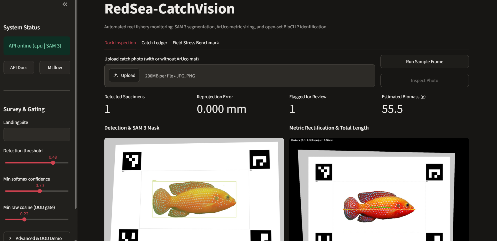
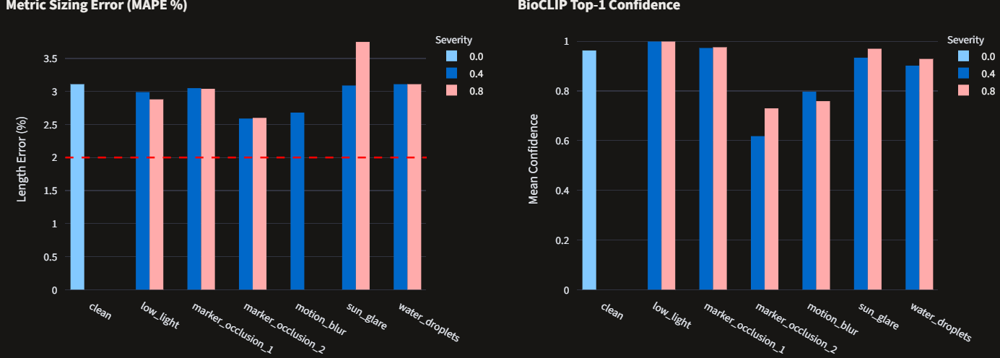
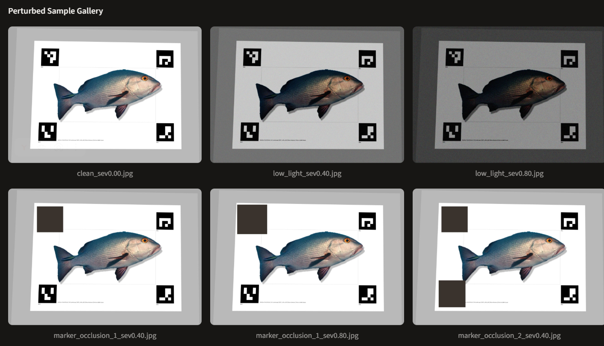

# RedSea-CatchVision

**A computer vision prototype for reef fishery surveys: zero-shot fish segmentation, ArUco metric sizing, species ID with OOD flagging, and biomass estimation.**

I built this project to explore how foundation vision models can automate dockside catch monitoring without requiring custom-trained detectors for every new reef species. Given a photo of fish on a printable A4 ArUco mat, the pipeline segments each specimen, corrects perspective distortion to measure curved total length, identifies the species via `BioCLIP`, and flags unfamiliar or edge-clipped fish for manual review.

---

## Preview


*Dockside inspection view: instance mask overlay, ArUco perspective rectification with geodesic Total Length (TL), allometric biomass estimate, and open-set species check.*

<details>
<summary>More screenshots: Stress Benchmark & Catch Ledger</summary>


*Synthetic robustness tests under glare, water droplets, low light, motion blur, and occluded markers.*


</details>

---

## How It Works

1. **Detection & Segmentation (`src/catchvision/vision/segmentor.py`)**  
   Detects fish with `GroundingDINO + SAM 2.1` (default) or single-pass `SAM 3` (`facebook/sam3`). Duplicate/nested boxes (e.g., fins inside a body box) are suppressed, and backgrounds are masked to neutral gray so reef or table textures do not bias classification.
2. **Perspective Sizing (`src/catchvision/geometry/calibration.py`)**  
   Uses a printable A4 landscape ArUco mat (`DICT_4X4_50`, 4 corner markers, fallback to 2 markers if occluded) to warp the frame into a top-down metric plane and measure curved **Total Length (TL)** along the fish's geodesic midline.
3. **Open-Set ID & Biomass (`src/catchvision/vision/classifier.py`, `biology/metrics.py`)**  
   Matches cropped fish against taxonomic/visual `BioCLIP` prompts for 15 Red Sea species, estimates weight via $W = a \cdot L^b$, and checks Minimum Legal Size (MLS). A dual threshold on softmax confidence (`0.70`) and raw cosine similarity (`0.22`) flags uncertain or out-of-distribution (OOD) species for review before saving to DuckDB.

---

## Experiments & Key Findings

### 1. Open-Set Species ID & OOD Check (`scripts/eval_redsea.py`)
Tested on unconstrained underwater iNaturalist photos across **10 Red Sea species** (30 frames) and **2 non-catalog OOD species** (*Diodon hystrix*, *Arothron stellatus*) using `SAM 3` (`box_threshold=0.28`):

| Metric | Result | Takeaway |
| :--- | :---: | :--- |
| **In-Dist Detection Rate** | **100.0%** (30/30) | `SAM 3` detected every target specimen across 30 underwater frames |
| **Zero-Shot Top-1 / Top-3** | **50.0% / 66.7%** | Strong zero-shot Top-1 without fine-tuning despite underwater color shifts |
| **In-Dist Median Cosine Sim** | **0.262** | Tighter `SAM 3` masks improve raw `BioCLIP` alignment |
| **OOD Max Cosine Sim** | **0.221** (`0.163–0.198` on 3/4) | Raw cosine exposes unfamiliar species even when softmax saturates |
| **OOD False Softmax Conf** | `0.50 – 0.998` | Closed-set softmax reaches `0.998` on an OOD pufferfish |
| **1-Shot Prototype Ablation** | `45.0%` (vs `50.0%` ZS) | Adding 1 noisy underwater photo still hurts accuracy due to lighting bias |

> **Why raw cosine matters:** On a camouflaged *Arothron stellatus* frame, closed-set softmax predicted *Epinephelus polyphekadion* with `0.998` confidence, whereas raw cosine similarity stayed at `0.221` (`0.163–0.198` on the remaining OOD detections), demonstrating why raw cosine gating is essential before logging catches.

### 2. Dockside Stress Benchmark (`Lutjanus_bohar_230mm.jpg`, 230.0 mm GT TL)
Tested synthetic degradations (`sun_glare`, `water_droplets`, `low_light`, `motion_blur`, and 1–2 occluded markers) at severities `0.4` and `0.8`:

| Metric | Result | Notes |
| :--- | :---: | :--- |
| **Calibration Success** | **100%** (11/12 scenarios) | Handles glare, droplets, low light, and up to 2 occluded markers; fails only at extreme motion blur (`0.8`) |
| **Mean Length Error (MAPE)** | **2.59% – 3.75%** (`6.0 – 8.7 mm` MAE) | Stable geodesic TL estimation across all calibrated perturbations |
| **Species Consistency** | **100%** (11/12 scenarios) | Consistent *Lutjanus bohar* identification even when extreme blur disables ArUco calibration |

---

## Current Limitations

- **Evaluation data:** Underwater iNaturalist photos have strong blue/green color shifts and varied angles; real dockside validation on a printed mat is still needed.
- **1-shot calibration:** Naive 1-shot prototypes degraded accuracy (`47.1% → 35.3%`); visual prototypes should only be built from clean, standardized mat photos.
- **SAM 3 thresholds & speed:** `SAM 3` produces tighter masks than `GroundingDINO + SAM 2.1` and outputs higher raw confidence scores (so `box_threshold` should be raised to `~0.45–0.55`), but it requires a GPU for interactive speeds and a Hugging Face token.

---

## Quickstart

```bash
git clone [https://github.com/DanilKras/RedSea_CatchVision.git](https://github.com/DanilKras/RedSea_CatchVision.git)
cd RedSea_CatchVision

# Start Streamlit UI (:8501), FastAPI (:8000), and MLflow (:5000)
docker compose up --build
```

To run locally with [`uv`](https://docs.astral.sh/uv/) (Python 3.12+):

```bash
uv sync
uv run pytest && uv run ruff check .
uv run python scripts/eval_redsea.py
```

<details>
<summary>Optional: Switching to SAM 3 or running services manually</summary>

### Using SAM 3 (`facebook/sam3`)
Accept the model terms on Hugging Face and create a `.env` file in the project root before starting Docker Compose:

```env
CATCHVISION_SEGMENTOR_BACKEND=sam3
HF_TOKEN=hf_your_read_token_here
```

### Manual Local Launch
```bash
uv run uvicorn catchvision.api.main:app --host 0.0.0.0 --port 8000 --workers 1
uv run streamlit run app/dashboard.py
```

Key thresholds can be adjusted via `CATCHVISION_*` env vars (see `src/catchvision/config.py`).

</details>

---

**Stack:** PyTorch, Transformers (`GroundingDINO`, `SAM 3`), Ultralytics (`SAM 2.1`), OpenCLIP (`BioCLIP`), OpenCV, scikit-image, FastAPI, Streamlit, DuckDB, MLflow.
